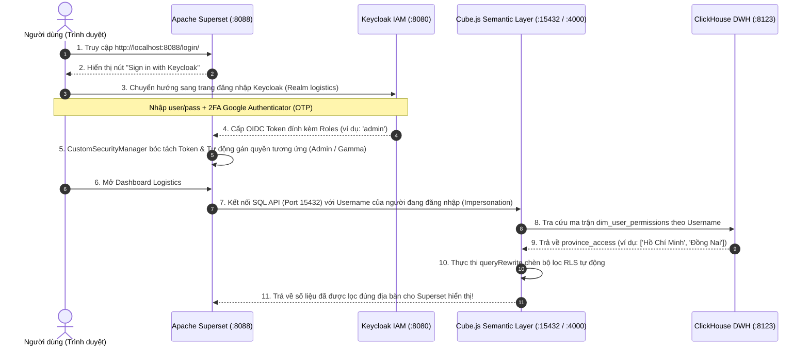

# 📊 Cẩm Nang Triển Khai BI Enterprise: Keycloak OIDC SSO (2FA OTP & Role Sync) + Apache Superset + Cube.js + ClickHouse RLS

Tài liệu này hướng dẫn chi tiết từng bước (A-Z) để bạn thực nghiệm **xác thực tập trung qua Keycloak (OIDC SSO)** với **bảo mật 2 lớp 2FA Google Authenticator**, **tự động đồng bộ quyền (Role Mapping)** từ Keycloak sang Superset, tự động hóa cài đặt thư viện `Authlib` qua `Dockerfile` & `requirements.txt`, và kết nối bảo mật với **Cube.dev** & **ClickHouse RLS**.

---

## 1. Kiến Trúc Thông Luồng Xác Thực & Phân Quyền (End-to-End Flow)



---

## 2. Quản Lý Thư Viện Tự Động (Dockerfile & requirements.txt)

Để **không bao giờ phải chạy lệnh `docker exec pip install` thủ công**, dự án đã được đóng gói chuẩn DevOps tại thư mục `cluster-4-bi`:

* **`cluster-4-bi/requirements.txt`**: Khai báo `Authlib>=1.3.0`.
* **`cluster-4-bi/Dockerfile`**: Tự động cài đặt dependencies khi build.
* **`cluster-4-bi/docker-compose.yml`**: Tự động build và chạy image `superset-enterprise:3.0.2`:
  ```yaml
    superset:
      build:
        context: .
        dockerfile: Dockerfile
      image: superset-enterprise:3.0.2
      container_name: superset_bi
      ...
      environment:
        ENABLE_KEYCLOAK: "true"
        KEYCLOAK_INTERNAL_URL: "http://keycloak:8080"
        KEYCLOAK_EXTERNAL_URL: "http://localhost:8080"
        KEYCLOAK_REALM: "logistics"
        KEYCLOAK_CLIENT_ID: "superset"
        KEYCLOAK_CLIENT_SECRET: "super-secret-keycloak-client-secret"
  ```

---

## 3. Các Bước Thực Nghiệm Từng Bước (Hands-on Steps)

### BƯỚC 1: Khởi động Cụm Keycloak IAM (`cluster-0-iam`)
Từ thư mục gốc dự án:
```bash
cd cluster-0-iam
docker compose up -d
cd ..
```
*Kiểm tra:* Mở trình duyệt truy cập `http://localhost:8080` $\rightarrow$ Thấy màn hình chào mừng của Keycloak.

---

### BƯỚC 2: Tạo Realm Mới Mang Tên `logistics` (Chuẩn Enterprise)

1. Đăng nhập Keycloak Admin Console: **`http://localhost:8080/admin/`** (Tài khoản: `admin` / `admin`).
2. Nhìn lên góc trên cùng bên trái màn hình, click vào menu trỏ xuống chữ **`master`** $\rightarrow$ Bấm nút **`Create Realm`**.
3. Điền thông tin:
   * **Realm name:** `logistics`
   * **Enabled:** Bật `ON`
4. Bấm nút **`Create`** màu xanh.
*(Từ bước này trở đi, mọi cấu hình Client, Role và User đều nằm bên trong Realm **`logistics`**).*

---

### BƯỚC 3: Tạo Client `superset` trong Realm `logistics`
1. Đảm bảo ở góc trên bên trái đang chọn Realm **`logistics`**.
2. Vào menu **Clients** $\rightarrow$ Bấm **Create client**:
   * **General Settings**:
     * Client type: `OpenID Connect`
     * Client ID: `superset`
     * Name: `Apache Superset BI`
     * Bấm **Next**.
   * **Capability config**:
     * Client authentication: Bật **ON** (để chế độ Confidential).
     * Authentication flow: Tích chọn cả **Standard flow** và **Direct access grants** (để vừa đăng nhập web vừa cho phép lấy token trực tiếp qua API/Postman).
     * Bấm **Next**.
   * **Login settings**:
     * Root URL: `http://localhost:8088`
     * Valid redirect URIs: `http://localhost:8088/oauth-authorized/keycloak`
     * Valid post logout redirect URIs: `http://localhost:8088/*`
     * Web origins: `http://localhost:8088`
     * Bấm **Save**.
3. Chuyển sang tab **Credentials**:
   * Copy chuỗi **Client Secret** (ví dụ: `gT3k9...`).
   * *(Nếu muốn dùng secret cố định cho tiện, bạn có thể dán `super-secret-keycloak-client-secret` hoặc cập nhật chuỗi vừa copy vào biến `KEYCLOAK_CLIENT_SECRET` trong file `cluster-4-bi/docker-compose.yml`)*.

---

### BƯỚC 4: Tạo Roles và Đồng Bộ Quyền Sang Superset (Role Mapping)

Đây là bước giúp Superset **tự động biết ai là Admin, ai là Phân tích viên (Alpha), ai là Người xem (Gamma)** ngay khi đăng nhập:

1. Trong Realm **`logistics`**, vào menu **Realm roles** (bên trái) $\rightarrow$ Bấm **Create role**:
   * Tạo Role 1: **`admin`** (Quản trị viên tối cao)
   * Tạo Role 2: **`superset_alpha`** (Phân tích viên được tạo biểu đồ mới)
2. **Cơ chế ánh xạ tự động đã được lập trình sẵn trong `cluster-4-bi/superset_config.py`:**
   ```python
   AUTH_ROLES_SYNC_AT_LOGIN = True
   AUTH_ROLES_MAPPING = {
       "admin": ["Admin"],            # Role 'admin' trên Keycloak -> Trao quyền 'Admin' Superset
       "superset_alpha": ["Alpha"],   # Role 'superset_alpha' -> Trao quyền 'Alpha'
       "manager": ["Gamma"],          # Role xem báo cáo
   }
   ```

---

### BƯỚC 5: (Tùy chọn) Kích Hoạt Bảo Mật 2 Lớp (2FA / Google Authenticator OTP)

1. Đảm bảo đang chọn Realm **`logistics`** $\rightarrow$ Vào menu **Authentication** (bên trái).
2. Chọn tab **Required actions**.
3. Tìm dòng **Configure OTP**:
   * Tích chọn cột **Set as default action**.
4. *Kết quả:* Mọi tài khoản khi đăng nhập lần đầu tiên sẽ bắt buộc phải dùng ứng dụng Google Authenticator trên điện thoại quét mã QR.

---

### BƯỚC 6: Tạo Các Tài Khoản Người Dùng Mẫu & Gán Quyền Trên Keycloak

Vào menu **Users** (trong Realm `logistics`) $\rightarrow$ Bấm **Add user**:

1. **Tài khoản Quản trị viên (Admin):**
   * Username: `admin`
   * Email: `admin@logistics.com`
   * First Name: `Admin`, Last Name: `Logistics` $\rightarrow$ Bấm **Create**.
   * Vào tab **Credentials** $\rightarrow$ Đặt Password: `admin` $\rightarrow$ Tắt cờ **Temporary** $\rightarrow$ Bấm **Save**.
   * 👉 **Gán quyền Admin:** Chuyển sang tab **Role mapping** $\rightarrow$ Bấm **Assign role** $\rightarrow$ Tích chọn role **`admin`** $\rightarrow$ Bấm **Assign**.

2. **Tài khoản Trưởng vùng Miền Bắc:**
   * Username: `manager_north`
   * Email: `manager_north@logistics.com`
   * First Name: `North`, Last Name: `Manager` $\rightarrow$ Bấm **Create**.
   * Vào tab **Credentials** $\rightarrow$ Đặt Password: `password123` $\rightarrow$ Tắt cờ **Temporary** $\rightarrow$ Bấm **Save**.
   *(Không cần gán role gì, Superset sẽ tự động gán vai trò người xem `Gamma`)*.

3. **Tài khoản Trưởng vùng Miền Nam:**
   * Username: `manager_south`
   * Email: `manager_south@logistics.com`
   * First Name: `South`, Last Name: `Manager` $\rightarrow$ Bấm **Create**.
   * Vào tab **Credentials** $\rightarrow$ Đặt Password: `password123` $\rightarrow$ Tắt cờ **Temporary** $\rightarrow$ Bấm **Save**.

4. **Tài khoản Tài xế:**
   * Username: `driver_hcm_01`
   * Email: `driver01@logistics.com`
   * First Name: `Driver`, Last Name: `HCM` $\rightarrow$ Bấm **Create**.
   * Vào tab **Credentials** $\rightarrow$ Đặt Password: `password123` $\rightarrow$ Tắt cờ **Temporary** $\rightarrow$ Bấm **Save**.

---

### BƯỚC 7: Khởi Động & Đồng Bộ Cụm BI (`cluster-4-bi`)
1. Khởi động container Superset để nhận cấu hình Realm `logistics`:
   ```bash
   cd cluster-4-bi
   docker compose up -d
   cd ..
   ```
2. Chạy file khởi tạo metadata database (nếu dựng môi trường mới):
   ```bash
   ./cluster-4-bi/init_superset.sh
   ```

---

### BƯỚC 8: Thử Nghiệm Đăng Nhập & Đồng Bộ Quyền Thực Tế Trên Superset
1. Mở trình duyệt ẩn danh (Incognito) truy cập: **`http://localhost:8088/login/`**.
2. Bấm vào nút: **`Sign In with keycloak`** (kèm icon chìa khóa 🔑).
3. **Thử nghiệm 1 (Đăng nhập Admin - Kiểm tra cấp quyền Admin tự động):**
   * Đăng nhập `admin` / `admin`.
   * **Kết quả:** Nhờ có Role Mapping, Superset tự động gán quyền **`Admin`** tối cao (bạn sẽ thấy đầy đủ menu *Settings*, *Database Connections*, *List Users*...).
4. **Thử nghiệm 2 (Đăng nhập Trưởng vùng - Kiểm tra quyền Gamma & RLS):**
   * Mở cửa sổ ẩn danh khác, đăng nhập `manager_south` / `password123`.
   * **Kết quả:** Vào Superset với vai trò **`Gamma`** (`South Manager`).

---

### BƯỚC 9: Kiểm Thử Kết Nối Bảo Mật Với Cube.js & ClickHouse RLS

1. **Đảm bảo ClickHouse có ma trận phân quyền:**
   ```bash
   docker exec -i clickhouse_dwh clickhouse-client < cluster-2-lakehouse-dwh/clickhouse_config/init_permissions.sql
   ```
2. **Khởi tạo Dashboard và liên kết Cube:**
   ```bash
   docker exec -it superset_bi python /app/create_logistics_dashboard.py
   ```
3. Khi `manager_south` xem Dashboard trên Superset:
   * Superset mạo danh user `manager_south` gửi query sang Cube.js SQL API (cổng 15432).
   * Cube.js đọc username `manager_south`, tra cứu ClickHouse thấy quyền: `province_access: ['Hồ Chí Minh', 'Đồng Nai']`.
   * Cube.js tự động tiêm `WHERE sendingProvince IN ('Hồ Chí Minh', 'Đồng Nai')`.
   * Dashboard chỉ hiển thị dữ liệu của 2 tỉnh phía Nam!

---


---

## 5. Hướng Dẫn Toàn Diện: Xác Thực Cube.dev API, Cấp Quyền Cho Đội AI & Kiểm Thử Bằng Postman

Mục này giải thích bản chất kiến trúc xác thực của Cube.dev, so sánh với cách làm truyền thống (MD5 Timestamp), chi tiết các loại API và hướng dẫn thực hành kiểm thử từ A-Z trên Postman cho cả 2 kịch bản: **Không có Keycloak** và **Có Keycloak**.

---

### 5.1. Bản Chất Xác Thực: MD5 Timestamp (Truyền Thống) vs. JWT HS256 (Cube.dev)

#### Cách làm truyền thống trước đây (MD5 Signature):
* **Cơ chế**: Phía Client (Đội AI) ghép `MD5(secret_key + timestamp + payload)` rồi gửi lên Header `X-Signature: <hash>` và `X-Timestamp: <thời gian>`.
* **Phía Server**: Bạn phải tự viết code trích xuất timestamp, kiểm tra độ lệch thời gian (ví dụ quá 5 phút thì hủy để chống Replay Attack), sau đó băm lại để so khớp chuỗi băm.
* **Hạn chế**: 
  1. Thuật toán MD5 ngày nay đã lỗi thời, dễ bị tấn công va chạm (collision attack).
  2. Bạn phải tự viết code xác thực cho từng endpoint.
  3. Không kèm sẵn thông tin định danh/phân quyền (claims) chuẩn hóa trong token.

#### Cơ chế hiện đại của Cube.dev (JWT với thuật toán HS256):
* **Cơ chế**: Cube.dev sử dụng tiêu chuẩn quốc tế **JWT (JSON Web Token - RFC 7519)**. Token gồm 3 phần được mã hóa Base64URL, ngăn cách bởi dấu chấm: `Header.Payload.Signature`.
  * **Header**: Khai báo thuật toán, ví dụ: `{"alg": "HS256", "typ": "JWT"}`.
  * **Payload (Claims)**: Chứa thông tin danh tính, vai trò và thời hạn sử dụng:
    ```json
    {
      "sub": "ai-service",
      "role": "ADMIN",
      "preferred_username": "admin",
      "exp": 1893456000
    }
    ```
  * **Signature**: Chữ ký bảo mật được tính bằng:
    $$	ext{Signature} = 	ext{HMAC-SHA256}(	ext{Base64}(Header) + "." + 	ext{Base64}(Payload), 	ext{CUBEJS\_API\_SECRET})$$
* **Điểm ưu việt**:
  1. **Tự động & Toàn vẹn**: Cube.dev được tích hợp sẵn engine kiểm tra JWT. Khi request đến kèm header `Authorization: Bearer <token>`, Cube tự động dùng biến môi trường `CUBEJS_API_SECRET` để verify chữ ký. Nếu ai đó sửa trộm Payload (ví dụ đổi role từ `GUEST` thành `ADMIN`), chữ ký lập tức vô hiệu và Cube từ chối với mã lỗi `403/401`.
  2. **Stateless**: Cube không cần query database để check session hay token có hợp lệ không, giúp chịu tải hàng nghìn request/giây từ AI Agent mà không tốn tài nguyên.

---

### 5.2. Giải Thích Các Loại API Trên Giao Diện Frontend Integrations Của Cube.dev

Cube.dev cung cấp 4 cổng giao tiếp phục vụ từng mục đích chuyên biệt:

| Loại Endpoint | Giao thức & Cổng | Mô tả chi tiết & Đối tượng sử dụng |
| :--- | :--- | :--- |
| **REST API** | HTTP/1.1 (`:4000/cubejs-api/v1/load`) | **Đây là API chính dành cho Đội AI / Backend Services**. Hỗ trợ cả phương thức `POST` (khuyên dùng, gửi JSON body) và `GET` (query params). Trả về dữ liệu JSON có cấu trúc. |
| **WebSockets** | WebSocket (`ws://:4000/`) | Dành cho các ứng dụng hiển thị thời gian thực (Real-time Dashboards). Kết nối duy trì liên tục hai chiều, server chủ động đẩy dữ liệu khi có thay đổi mà client không cần gửi request hỏi liên tục (polling). |
| **GraphQL** | HTTP GraphQL (`:4000/cubejs-api/graphql`) | Dành cho các lập trình viên Frontend thích cú pháp GraphQL (`query { shipments { count, sendingProvince } }`) để chủ động chỉ định chính xác các trường cần lấy. |
| **SQL API** | Postgres Wire Protocol (`:15432`) | Cổng giả lập PostgreSQL. **Dành cho BI tools** (Apache Superset, PowerBI, Tableau, DBeaver) kết nối như một database thực thụ. |

---

### 5.3. Hướng Dẫn Kiểm Thử Trên Postman (Hands-on Postman Testing)

Bạn có thể tải và cài đặt [Postman](https://www.postman.com/downloads/) (hoặc dùng tiện ích Thunder Client / REST Client trên VS Code).

#### Phương thức gọi chuẩn dành cho đội AI:
* **HTTP Method**: `POST`
* **Request URL**: `http://localhost:4000/cubejs-api/v1/load`
* **Headers**:
  * `Content-Type: application/json`
  * `Authorization: Bearer <TOKEN_JWT>`
* **Body** (chọn tab `raw` $
ightarrow$ `JSON`):
  ```json
  {
    "query": {
      "measures": [
        "Shipments.count",
        "Shipments.totalRevenue"
      ],
      "dimensions": [
        "Shipments.sendingProvince"
      ],
      "timeDimensions": [
        {
          "dimension": "Shipments.bookingDate",
          "granularity": "month",
          "dateRange": "This year"
        }
      ]
    }
  }
  ```

---

### 5.4. KỊCH BẢN 1: Kiểm Thử KHÔNG CÓ Keycloak (Dùng JWT HS256 Trực Tiếp - Có Hạn Dùng 1 Phút)

Trong kịch bản này, bạn là Data Engineer quản lý Cube, bạn tự tạo token JWT được ký bởi khóa `CUBEJS_API_SECRET` (`logistics-super-secret`) và bàn giao cho đội AI.

#### Bước 1: Tạo Token JWT Có Hạn Đúng 60 Giây (1 Phút)
Chạy lệnh Python sau trên Terminal:
```bash
python3 -c "import jwt, time; print(jwt.encode({'sub': 'ai-agent-service', 'role': 'REGIONAL_MANAGER', 'preferred_username': 'manager_south', 'iat': int(time.time()), 'exp': int(time.time()) + 60}, 'logistics-super-secret', algorithm='HS256'))"
```
* **Giải thích các tham số thời gian**:
  * `'iat': int(time.time())`: Thời điểm cấp token (Issued At).
  * `'exp': int(time.time()) + 60`: Hết hạn chính xác sau 60 giây kể từ lúc bấm Enter.

#### Bước 2: Bắn Request trên Postman
1. Mở Postman, tạo một Request mới:
   * **Method**: `POST`
   * **URL**: `http://localhost:4000/cubejs-api/v1/load`
2. Chọn tab **Authorization**:
   * **Type**: Chọn `Bearer Token`.
   * **Token**: Dán chuỗi JWT vừa tạo ở Bước 1 vào.
3. Chọn tab **Body** $\rightarrow$ tích chọn **raw** $\rightarrow$ chọn **JSON**, dán vào:
   ```json
   {
     "query": {
       "measures": ["Shipments.count"],
       "dimensions": ["Shipments.sendingProvince"]
     }
   }
   ```
4. Bấm **Send NGAY trong vòng 60 giây đầu**:
   * **Kết quả**: HTTP `200 OK`. Dữ liệu trả về chỉ có của **Hồ Chí Minh** và **Đồng Nai** (do user là `manager_south`).

#### Bước 3: Kiểm Thử Hết Hạn Token (Expire Test)
* Đợi qua 60 giây $\rightarrow$ Bấm nút **Send** lại trên Postman:
* **Kết quả thực tế**: Cube chặn đứng ngay lập tức với mã lỗi `403 Forbidden` kèm thông báo:
  ```json
  {
    "error": "TokenExpiredError: jwt expired"
  }
  ```
  *(Điều này chứng minh cơ chế kiểm tra `exp` của Cube.dev hoạt động chuẩn xác đến từng giây!).*

---

### 5.5. KỊCH BẢN 2: Kiểm Thử CÓ Keycloak (Client Credentials + Truyền User Định Danh RLS)

Trong môi trường Enterprise chuẩn:
- Đội AI kết nối qua giao thức **Machine-to-Machine (`client_credentials`)** để xác thực server.
- Để Cube biết phải phân quyền RLS cho ai, AI Service sẽ truyền tên người dùng qua Header **`x-user`** (đã được lập trình sẵn tại dòng 68 trong `cube.js`).

#### Bước 1: Lấy Token từ Keycloak bằng Client Credentials
1. Mở Postman, tạo Request:
   * **Method**: `POST`
   * **URL**: `http://localhost:8080/realms/logistics/protocol/openid-connect/token`
2. Chọn tab **Body** $\rightarrow$ chọn **x-www-form-urlencoded**:
   * `grant_type`: `client_credentials`
   * `client_id`: `superset` (Client đã bật Service accounts roles)
   * `client_secret`: `eoHUQRNM9qxa4XnYvz53rHqf7x3ZRccQ`
3. Bấm **Send**:
   * Keycloak sẽ trả về:
     ```json
     {
       "access_token": "eyJhbGciOiJSUzI1NiIsInR5cCI...",
       "expires_in": 300,
       "refresh_expires_in": 1800,
       "token_type": "Bearer"
     }
     ```
   * **Ý nghĩa các trường**:
     * **`access_token`**: Vé vào cửa để gọi API Cube.dev.
     * **`expires_in: 300`**: Vé vào cửa này có hiệu lực trong **300 giây (5 phút)**.
     * **`refresh_expires_in: 1800`**: Thời hạn phiên làm việc tối đa (1800 giây = **30 phút**).
4. Copy toàn bộ giá trị `access_token`.

#### Bước 2: Gọi Cube.dev REST API Kèm User Cần Lọc RLS
1. Mở Request gọi Cube (`POST http://localhost:4000/cubejs-api/v1/load`).
2. Vào tab **Authorization** $\rightarrow$ **Bearer Token** $\rightarrow$ Dán `access_token` của Keycloak vào.
3. Vào tab **Headers**, thêm một header mới:
   * **Key**: `x-user`
   * **Value**: `manager_south` (hoặc `manager_north` / `admin`)
4. Chọn tab **Body** (raw JSON):
   ```json
   {
     "query": {
       "measures": ["Shipments.count"],
       "dimensions": ["Shipments.sendingProvince"]
     }
   }
   ```
5. Bấm **Send**:
   * **Kết quả**: Cube xác thực token Keycloak hợp lệ, bóc header `x-user: manager_south`, tự động truy vấn ClickHouse và trả về **chỉ số liệu của Miền Nam**! Nếu bạn đổi `x-user` thành `manager_north`, kết quả lập tức đổi sang dữ liệu của Miền Bắc!

---

### 5.6. Tổng Kết: Khuyến Nghị Cho Bạn Khi Bàn Giao API Cho Đội AI

1. **Giai đoạn phát triển (Dev/PoC)**: 
   * Bạn tạo một JWT token HS256 có hạn sử dụng dài hạn (ví dụ 1 năm) với `preferred_username: "admin"` hoặc `ai_service`.
   * Cung cấp cho đội AI:
     - URL REST API: `http://<ip-server>:4000/cubejs-api/v1/load`
     - Header: `Authorization: Bearer <TOKEN>`
     - Cung cấp thêm API metadata: `GET http://<ip-server>:4000/cubejs-api/v1/meta` để AI Agent tự đọc danh sách `measures` và `dimensions` hợp lệ.
2. **Giai đoạn lên Production**:
   * Chuyển sang mô hình **Keycloak Client Credentials**: Cấp `client_id` và `client_secret` của Realm `logistics` cho hệ thống AI tự động refresh token định kỳ.

---

## 4. Lưu Trữ và Đẩy (Push) Lên GitHub

Sau khi hoàn tất thử nghiệm, lưu lại toàn bộ tiến độ lên nhánh `feature/enterprise-keycloak-sso`:

```bash
git status
git add cluster-4-bi/
git add GUIDE_BI_CUBE_SUPERSET.md
git commit -m "feat(iam): add custom security manager for keycloak role mapping and sync"
git push origin feature/enterprise-keycloak-sso
```
