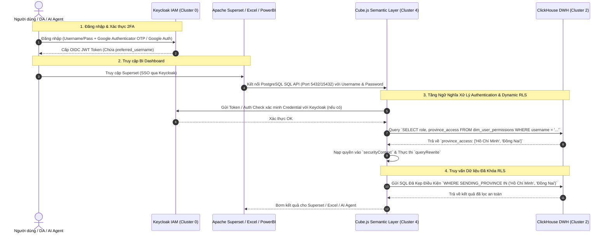

# 📊 Hướng Dẫn Thông Luồng BI Enterprise Nâng Cao: Keycloak IAM (Google Authenticator 2FA) + ClickHouse Permissions + Cube.js RLS + Apache Superset

> [!NOTE]
> **Tài Liệu Mở Rộng Dành Cho Môi Trường Doanh Nghiệp (Enterprise IAM / SSO):**
> Tài liệu này hướng dẫn kịch bản triển khai **Đầy Đủ Cụm 0 (Keycloak IAM)** với xác thực 2 lớp Google Authenticator (TOTP), Single Sign-On (SSO) và OIDC Token.
> *(Nếu bạn chỉ muốn **kiểm thử luồng BI độc lập, nhanh gọn không cần Keycloak**, vui lòng xem trực tiếp **Bước 11** trong file [GUIDE_END_TO_END_TESTING.md](file:///home/tambt/Projects/Enterprise-Logistics-Data-Hub/GUIDE_END_TO_END_TESTING.md))*.

---

## 1. Kiến Trúc Bảo Mật & Thông Luồng Dữ Liệu (End-to-End Architecture)

Trong kiến trúc Modern Data Stack Enterprise, việc phân quyền dữ liệu (Row-Level Security - RLS) **bắt buộc phải diễn ra tại Tầng Ngữ Nghĩa (Cube.js Semantic Layer)** thay vì tầng hiển thị (Superset) hay tầng lưu trữ thô. Điều này đảm bảo mọi kênh truy cập (Dashboard Superset, Excel Ad-hoc Pivot qua SQL API, hoặc AI Agents qua REST API) đều tuân thủ chung một chính sách bảo mật duy nhất.



---

## 2. Cấu Hình Keycloak IAM Server (Cluster 0 - IAM)

Keycloak đóng vai trò là **Identity Provider (IdP)** trung tâm cho toàn bộ Data Hub.

### 2.1. Khởi chạy Cụm IAM
```bash
cd cluster-0-iam && docker compose up -d
```
* Keycloak Console: `http://localhost:8080` (Tài khoản mặc định: `admin` / `admin`).

### 2.2. Cấu hình Bảo Mật 2 Lớp (2FA / Google Authenticator OTP)
1. Đăng nhập vào Keycloak Admin Console.
2. Tại menu bên trái, chọn **Realm Settings** $\rightarrow$ chọn tab **Authentication**.
3. Chọn tab **Required Actions**.
4. Tìm mục **Configure OTP** $\rightarrow$ Tích chọn **Enabled** và **Set Default Action**.
5. *Kết quả:* Khi bất kỳ người dùng nào đăng nhập lần đầu, Keycloak sẽ bắt buộc họ sử dụng điện thoại quét mã QR bằng ứng dụng **Google Authenticator** (hoặc FreeOTP) và nhập mã 6 chữ số TOTP trước khi vào hệ thống.

### 2.3. Cấu hình Google Login (Google Identity Provider)
1. Truy cập [Google Cloud Console](https://console.cloud.google.com/) $\rightarrow$ **APIs & Services** $\rightarrow$ **Credentials**.
2. Tạo **OAuth 2.0 Client ID** (Web application).
3. Đặt Authorized redirect URIs: `http://localhost:8080/realms/master/broker/google/endpoint`.
4. Lấy `Client ID` và `Client Secret`.
5. Trong Keycloak Console: Vào **Identity Providers** $\rightarrow$ Chọn **Google** $\rightarrow$ Dán `Client ID` và `Client Secret` $\rightarrow$ Bấm **Save**.

### 2.4. Đăng Ký OIDC Clients cho Superset & Cube
* **Client 1: `superset`**
  * Client ID: `superset`
  * Client Protocol: `openid-connect`
  * Access Type: `confidential`
  * Valid Redirect URIs: `http://localhost:8088/oauth-authorized/keycloak`
* **Client 2: `cube`**
  * Client ID: `cube`
  * Client Protocol: `openid-connect`
  * Direct Access Grants Enabled: `true` (Cho phép xác thực tài khoản qua API).

---

## 3. Thiết Kế Bảng Phân Quyền (`dim_user_permissions`) trên ClickHouse

Thay vì fix cứng quyền trong code, ma trận phân quyền người dùng được lưu trữ trực tiếp tại Data Warehouse ClickHouse dưới dạng bảng Dimension. Data Engineer có thể dùng dbt hoặc nạp từ script [init_permissions.sql](file:///home/tambt/Projects/Enterprise-Logistics-Data-Hub/cluster-2-lakehouse-dwh/clickhouse_config/init_permissions.sql):

```bash
docker exec -i clickhouse_dwh clickhouse-client < cluster-2-lakehouse-dwh/clickhouse_config/init_permissions.sql
```

Bảng phân quyền có cấu trúc:
```sql
CREATE TABLE IF NOT EXISTS default.dim_user_permissions (
    username String,                -- Username / Email khớp với Keycloak (VD: manager_south)
    role String,                    -- Vai trò: ADMIN, REGIONAL_MANAGER, DRIVER, STAFF
    province_access Array(String),  -- Mảng danh sách tỉnh thành được phép xem (hoặc ['ALL'])
    updated_at DateTime DEFAULT now()
) ENGINE = MergeTree()
ORDER BY username;
```

---

## 4. Cấu Hình Cửa Khẩu Bảo Mật Cube.js (Semantic Layer)

Mã nguồn tại [cube.js](file:///home/tambt/Projects/Enterprise-Logistics-Data-Hub/cluster-4-bi/cube_conf/cube.js) đóng vai trò là "Cửa khẩu Security", thực hiện các nhiệm vụ:
1. **Xác thực Credential** của User với Keycloak IAM (hoặc fallback khi chạy dev).
2. **Truy vấn ClickHouse** lấy danh sách tỉnh thành được phân quyền cho User và nạp vào `securityContext`.
3. **Thực thi `queryRewrite`**: Tự động chặn lọc dòng dữ liệu theo tỉnh thành đối với MỌI truy vấn (REST API, GraphQL, và SQL API giả lập PostgreSQL).

### 4.1. Schema YAML Định Nghĩa Chỉ Số Logistics ([Shipments.yml](file:///home/tambt/Projects/Enterprise-Logistics-Data-Hub/cluster-4-bi/cube_conf/schema/Shipments.yml))

```yaml
cubes:
  - name: Shipments
    sql: SELECT * FROM default.obt_shipment_analytics

    measures:
      - name: totalBookings
        type: count
        title: Tổng Số Đơn Hàng

      - name: totalRevenue
        sql: TOTAL_REVENUE
        type: sum
        title: Tổng Doanh Thu (VND)
        format: currency

      - name: totalProfit
        sql: PROFIT_AMOUNT
        type: sum
        title: Tổng Lợi Nhuận (VND)
        format: currency

    dimensions:
      - name: bookingId
        sql: BOOKING_ID
        type: string
        primary_key: true
        title: Mã Đơn Hàng

      - name: bookingDate
        sql: BOOKING_DATE
        type: time
        title: Ngày Gửi Hàng

      - name: sendingProvince
        sql: SENDING_PROVINCE
        type: string
        title: Tỉnh Gửi

      - name: receivingProvince
        sql: RECEIVING_PROVINCE
        type: string
        title: Tỉnh Nhận

      - name: statusName
        sql: STATUS_NAME
        type: string
        title: Trạng Thái Đơn
```

---

## 5. Khởi Chạy & Kết Nối Apache Superset BI

### 5.1. Khởi động Cụm 4
```bash
cd cluster-4-bi && docker compose up -d
```
Cổng dịch vụ:
* **Cube Developer Playground & REST API**: `http://localhost:4000`
* **Apache Superset Web UI**: `http://localhost:8088` (Tài khoản: `admin` / `admin`)
* **Cube SQL API (PostgreSQL Wire Protocol)**:
  * Từ container Superset: `cube_semantic_layer:5432`
  * Từ máy host (DBeaver, PowerBI): `localhost:15432`

### 5.2. Kết nối Superset vào Cube Semantic Layer
1. Mở trình duyệt truy cập: `http://localhost:8088` $\rightarrow$ Đăng nhập `admin` / `admin`.
2. Chọn biểu tượng **Settings (bánh răng)** góc trên bên phải $\rightarrow$ Chọn **Database Connections** $\rightarrow$ Bấm **+ Database**.
3. Chọn loại Database: **PostgreSQL** (Giao thức giả lập chuẩn của Cube SQL API).
4. Điền chuỗi **SQLAlchemy URI**:
   ```text
   postgresql://manager_south:<password>@cube_semantic_layer:5432/default
   ```
5. Bấm **Test Connection** $\rightarrow$ Thấy thông báo màu xanh `Connection looks good!` $\rightarrow$ Bấm **Connect**.
6. Vào mục **SQL Lab** $\rightarrow$ **SQL Editor** $\rightarrow$ Chạy truy vấn:
   ```sql
   SELECT sendingProvince, totalBookings, totalRevenue FROM Shipments;
   ```
   *Dữ liệu trả về sẽ tự động bị giới hạn duy nhất tại 2 tỉnh Hồ Chí Minh và Đồng Nai theo đúng quyền hạn!*

---

## 6. Bảng Tổng Hợp Kiểm Thử Kịch Bản Enterprise

| Kịch Bản | Thao Tác | Kết Quả Kỳ Vọng |
| :--- | :--- | :--- |
| **1. Đăng nhập Keycloak 2FA** | Truy cập Keycloak với user `manager_south` lần đầu. | Keycloak yêu cầu quét mã QR bằng Google Authenticator và nhập mã OTP 6 chữ số thành công. |
| **2. Admin Query Toàn Quốc** | Dùng user `admin` query chỉ số qua SQL API hoặc Playground (`http://localhost:4000`). | Cube sinh câu lệnh SQL chọc xuống ClickHouse **không có WHERE lọc tỉnh**, trả về đầy đủ 9 tỉnh toàn quốc (50,101 đơn hàng). |
| **3. Manager Miền Nam Query (RLS)** | Dùng user `manager_south` query qua SQL API (`cube_semantic_layer:5432`). | Cube tự động rewrite SQL thành: `WHERE sendingProvince IN ('Hồ Chí Minh', 'Đồng Nai')`, chỉ hiển thị số liệu các tỉnh phía Nam. |
| **4. AI Agent Truy Cấp REST API** | AI Agent gửi HTTP Request: <br>`POST http://localhost:4000/cubejs-api/v1/load` <br>kèm Header `Authorization: Bearer <Keycloak_JWT>`. | Cube giải mã JWT token, kiểm tra ma trận `dim_user_permissions` ở ClickHouse và trả về kết quả JSON đã được lọc RLS chính xác. |

---

🎉 **Hoàn tất!** Hệ thống đạt chuẩn bảo mật cấp Doanh nghiệp: Keycloak 2FA (Google Authenticator) quản lý SSO $\rightarrow$ ClickHouse lưu ma trận phân quyền $\rightarrow$ Cube.js thực thi RLS động tại Semantic Layer $\rightarrow$ Superset & AI Agents khai thác dữ liệu an toàn tuyệt đối!
