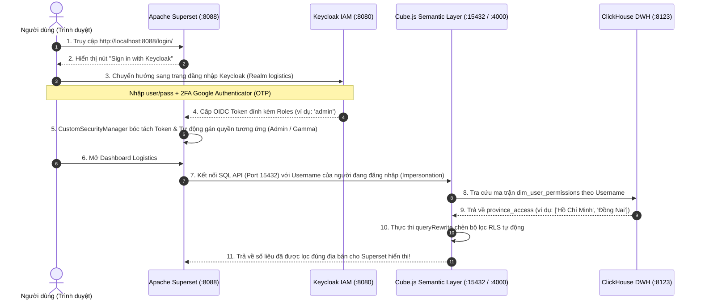

# 📊 Cẩm Nang Triển Khai BI Enterprise: Keycloak OIDC SSO (2FA OTP & Role Sync) + Apache Superset + Cube.js + ClickHouse RLS

Tài liệu này hướng dẫn chi tiết từng bước (A-Z) để bạn thực nghiệm **xác thực tập trung qua Keycloak (OIDC SSO)** với **bảo mật 2 lớp 2FA Google Authenticator**, **tự động đồng bộ quyền (Role Mapping)** từ Keycloak sang Superset, tự động hóa cài đặt thư viện `Authlib` qua `Dockerfile` & `requirements.txt`, và kết nối bảo mật với **Cube.dev** & **ClickHouse RLS**.

---

## 1. Kiến Trúc Thông Luồng Xác Thực & Phân Quyền (End-to-End Flow)



---

## 2. Quản Lý Thư Viện Tự Động (Dockerfile & requirements.txt)

Để **không bao giờ phải chạy lệnh `docker exec pip install` thủ công**, dự án đã được đóng gói chuẩn DevOps tại thư mục `cluster-4-bi`:

* **`cluster-4-bi/requirements.txt`**: Khai báo `Authlib>=1.3.0`.
* **`cluster-4-bi/Dockerfile`**: Tự động cài đặt dependencies khi build.
* **`cluster-4-bi/docker-compose.yml`**: Tự động build và chạy image `superset-enterprise:3.0.2`:
  ```yaml
    superset:
      build:
        context: .
        dockerfile: Dockerfile
      image: superset-enterprise:3.0.2
      container_name: superset_bi
      ...
      environment:
        ENABLE_KEYCLOAK: "true"
        KEYCLOAK_INTERNAL_URL: "http://keycloak:8080"
        KEYCLOAK_EXTERNAL_URL: "http://localhost:8080"
        KEYCLOAK_REALM: "logistics"
        KEYCLOAK_CLIENT_ID: "superset"
        KEYCLOAK_CLIENT_SECRET: "super-secret-keycloak-client-secret"
  ```

---

## 3. Các Bước Thực Nghiệm Từng Bước (Hands-on Steps)

### BƯỚC 1: Khởi động Cụm Keycloak IAM (`cluster-0-iam`)
Từ thư mục gốc dự án:
```bash
cd cluster-0-iam
docker compose up -d
cd ..
```
*Kiểm tra:* Mở trình duyệt truy cập `http://localhost:8080` $\rightarrow$ Thấy màn hình chào mừng của Keycloak.

---

### BƯỚC 2: Tạo Realm Mới Mang Tên `logistics` (Chuẩn Enterprise)

1. Đăng nhập Keycloak Admin Console: **`http://localhost:8080/admin/`** (Tài khoản: `admin` / `admin`).
2. Nhìn lên góc trên cùng bên trái màn hình, click vào menu trỏ xuống chữ **`master`** $\rightarrow$ Bấm nút **`Create Realm`**.
3. Điền thông tin:
   * **Realm name:** `logistics`
   * **Enabled:** Bật `ON`
4. Bấm nút **`Create`** màu xanh.
*(Từ bước này trở đi, mọi cấu hình Client, Role và User đều nằm bên trong Realm **`logistics`**).*

---

### BƯỚC 3: Tạo Client `superset` trong Realm `logistics`
1. Đảm bảo ở góc trên bên trái đang chọn Realm **`logistics`**.
2. Vào menu **Clients** $\rightarrow$ Bấm **Create client**:
   * **General Settings**:
     * Client type: `OpenID Connect`
     * Client ID: `superset`
     * Name: `Apache Superset BI`
     * Bấm **Next**.
   * **Capability config**:
     * Client authentication: Bật **ON** (để chế độ Confidential).
     * Authentication flow: Tích chọn **Standard flow**.
     * Bấm **Next**.
   * **Login settings**:
     * Root URL: `http://localhost:8088`
     * Valid redirect URIs: `http://localhost:8088/oauth-authorized/keycloak`
     * Valid post logout redirect URIs: `http://localhost:8088/*`
     * Web origins: `http://localhost:8088`
     * Bấm **Save**.
3. Chuyển sang tab **Credentials**:
   * Copy chuỗi **Client Secret** (ví dụ: `gT3k9...`).
   * *(Nếu muốn dùng secret cố định cho tiện, bạn có thể dán `super-secret-keycloak-client-secret` hoặc cập nhật chuỗi vừa copy vào biến `KEYCLOAK_CLIENT_SECRET` trong file `cluster-4-bi/docker-compose.yml`)*.

---

### BƯỚC 4: Tạo Roles và Đồng Bộ Quyền Sang Superset (Role Mapping)

Đây là bước giúp Superset **tự động biết ai là Admin, ai là Phân tích viên (Alpha), ai là Người xem (Gamma)** ngay khi đăng nhập:

1. Trong Realm **`logistics`**, vào menu **Realm roles** (bên trái) $\rightarrow$ Bấm **Create role**:
   * Tạo Role 1: **`admin`** (Quản trị viên tối cao)
   * Tạo Role 2: **`superset_alpha`** (Phân tích viên được tạo biểu đồ mới)
2. **Cơ chế ánh xạ tự động đã được lập trình sẵn trong `cluster-4-bi/superset_config.py`:**
   ```python
   AUTH_ROLES_SYNC_AT_LOGIN = True
   AUTH_ROLES_MAPPING = {
       "admin": ["Admin"],            # Role 'admin' trên Keycloak -> Trao quyền 'Admin' Superset
       "superset_alpha": ["Alpha"],   # Role 'superset_alpha' -> Trao quyền 'Alpha'
       "manager": ["Gamma"],          # Role xem báo cáo
   }
   ```

---

### BƯỚC 5: (Tùy chọn) Kích Hoạt Bảo Mật 2 Lớp (2FA / Google Authenticator OTP)

1. Đảm bảo đang chọn Realm **`logistics`** $\rightarrow$ Vào menu **Authentication** (bên trái).
2. Chọn tab **Required actions**.
3. Tìm dòng **Configure OTP**:
   * Tích chọn cột **Set as default action**.
4. *Kết quả:* Mọi tài khoản khi đăng nhập lần đầu tiên sẽ bắt buộc phải dùng ứng dụng Google Authenticator trên điện thoại quét mã QR.

---

### BƯỚC 6: Tạo Các Tài Khoản Người Dùng Mẫu & Gán Quyền Trên Keycloak

Vào menu **Users** (trong Realm `logistics`) $\rightarrow$ Bấm **Add user**:

1. **Tài khoản Quản trị viên (Admin):**
   * Username: `admin`
   * Email: `admin@logistics.com`
   * First Name: `Admin`, Last Name: `Logistics` $\rightarrow$ Bấm **Create**.
   * Vào tab **Credentials** $\rightarrow$ Đặt Password: `admin` $\rightarrow$ Tắt cờ **Temporary** $\rightarrow$ Bấm **Save**.
   * 👉 **Gán quyền Admin:** Chuyển sang tab **Role mapping** $\rightarrow$ Bấm **Assign role** $\rightarrow$ Tích chọn role **`admin`** $\rightarrow$ Bấm **Assign**.

2. **Tài khoản Trưởng vùng Miền Bắc:**
   * Username: `manager_north`
   * Email: `manager_north@logistics.com`
   * First Name: `North`, Last Name: `Manager` $\rightarrow$ Bấm **Create**.
   * Vào tab **Credentials** $\rightarrow$ Đặt Password: `password123` $\rightarrow$ Tắt cờ **Temporary** $\rightarrow$ Bấm **Save**.
   *(Không cần gán role gì, Superset sẽ tự động gán vai trò người xem `Gamma`)*.

3. **Tài khoản Trưởng vùng Miền Nam:**
   * Username: `manager_south`
   * Email: `manager_south@logistics.com`
   * First Name: `South`, Last Name: `Manager` $\rightarrow$ Bấm **Create**.
   * Vào tab **Credentials** $\rightarrow$ Đặt Password: `password123` $\rightarrow$ Tắt cờ **Temporary** $\rightarrow$ Bấm **Save**.

4. **Tài khoản Tài xế:**
   * Username: `driver_hcm_01`
   * Email: `driver01@logistics.com`
   * First Name: `Driver`, Last Name: `HCM` $\rightarrow$ Bấm **Create**.
   * Vào tab **Credentials** $\rightarrow$ Đặt Password: `password123` $\rightarrow$ Tắt cờ **Temporary** $\rightarrow$ Bấm **Save**.

---

### BƯỚC 7: Khởi Động & Đồng Bộ Cụm BI (`cluster-4-bi`)
1. Khởi động container Superset để nhận cấu hình Realm `logistics`:
   ```bash
   cd cluster-4-bi
   docker compose up -d
   cd ..
   ```
2. Chạy file khởi tạo metadata database (nếu dựng môi trường mới):
   ```bash
   ./cluster-4-bi/init_superset.sh
   ```

---

### BƯỚC 8: Thử Nghiệm Đăng Nhập & Đồng Bộ Quyền Thực Tế Trên Superset
1. Mở trình duyệt ẩn danh (Incognito) truy cập: **`http://localhost:8088/login/`**.
2. Bấm vào nút: **`Sign In with keycloak`** (kèm icon chìa khóa 🔑).
3. **Thử nghiệm 1 (Đăng nhập Admin - Kiểm tra cấp quyền Admin tự động):**
   * Đăng nhập `admin` / `admin`.
   * **Kết quả:** Nhờ có Role Mapping, Superset tự động gán quyền **`Admin`** tối cao (bạn sẽ thấy đầy đủ menu *Settings*, *Database Connections*, *List Users*...).
4. **Thử nghiệm 2 (Đăng nhập Trưởng vùng - Kiểm tra quyền Gamma & RLS):**
   * Mở cửa sổ ẩn danh khác, đăng nhập `manager_south` / `password123`.
   * **Kết quả:** Vào Superset với vai trò **`Gamma`** (`South Manager`).

---

### BƯỚC 9: Kiểm Thử Kết Nối Bảo Mật Với Cube.js & ClickHouse RLS

1. **Đảm bảo ClickHouse có ma trận phân quyền:**
   ```bash
   docker exec -i clickhouse_dwh clickhouse-client < cluster-2-lakehouse-dwh/clickhouse_config/init_permissions.sql
   ```
2. **Khởi tạo Dashboard và liên kết Cube:**
   ```bash
   docker exec -it superset_bi python /app/create_logistics_dashboard.py
   ```
3. Khi `manager_south` xem Dashboard trên Superset:
   * Superset mạo danh user `manager_south` gửi query sang Cube.js SQL API (cổng 15432).
   * Cube.js đọc username `manager_south`, tra cứu ClickHouse thấy quyền: `province_access: ['Hồ Chí Minh', 'Đồng Nai']`.
   * Cube.js tự động tiêm `WHERE sendingProvince IN ('Hồ Chí Minh', 'Đồng Nai')`.
   * Dashboard chỉ hiển thị dữ liệu của 2 tỉnh phía Nam!

---

## 4. Lưu Trữ và Đẩy (Push) Lên GitHub

Sau khi hoàn tất thử nghiệm, lưu lại toàn bộ tiến độ lên nhánh `feature/enterprise-keycloak-sso`:

```bash
git status
git add cluster-4-bi/
git add GUIDE_BI_CUBE_SUPERSET.md
git commit -m "feat(iam): add custom security manager for keycloak role mapping and sync"
git push origin feature/enterprise-keycloak-sso
```
